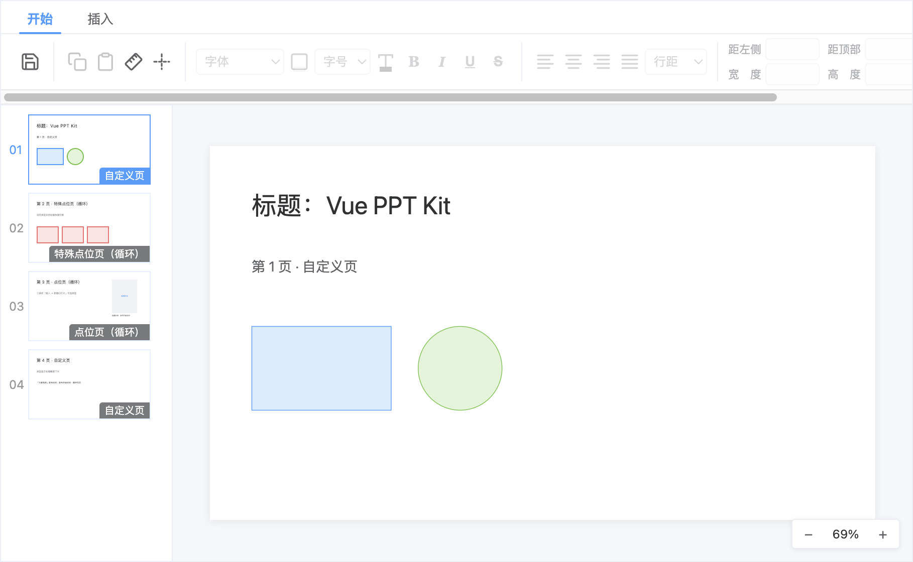

# vue-ppt

面向业务场景的 Vue 2.6 / Vue 3 双版本 PPT 编辑器组件库。核心逻辑沉淀在框架无关的 `core` 包中，Vue 2 与 Vue 3 两侧提供同构的编辑器组件，交互与数据模型完全一致。



## 特性

- **完整编辑器**：顶部工具栏 + 左侧幻灯片缩略图（拖拽排序）+ 画布编辑区
- **丰富的元素类型**：文本（富文本）、业务文本（业务字段 tag 混排）、图片、形状（矩形/椭圆/直线）、表格、富表格、媒体组件（图片 + 级联选照片 + 关联业务文本）
- **画布交互**：
  - 元素拖动 / 8 向手柄缩放（文本类仅左右，角手柄 + Shift 锁定宽高比）
  - 对齐吸附线：目标边/中心与其他元素、画布边界自动对齐
  - 按住 `空格` + 拖动鼠标平移画布；`Ctrl + 滚轮` 缩放画布（拖拽后缩放以视口中心为锚点，不跳动）
  - 标尺、参考线、元素右键菜单（对齐 / 层级 / 删除等）
- **文档模型驱动**：`PptDocumentModel` 纯 JSON 结构，传入 `document` 即可编辑，`@save` 事件回交宿主持久化
- **双端一致**：几何算法、富文本内核（ProseMirror）、快捷键、元素工厂均在 `core` 内共享，Vue 2 / Vue 3 组件行为对齐
- **主题可定制**：CSS 变量（`--vpk-primary` 等）统一换肤

## 包结构

| 包 | 说明 |
| --- | --- |
| `@vue-ppt/core` | 框架无关核心：文档模型、几何吸附算法、ProseMirror 富文本内核、快捷键、元素工厂、工具栏预设 |
| `@vue-ppt/vue2` | Vue 2.6 编辑器组件（`PptStage`），基于 `@vue/composition-api` |
| `@vue-ppt/vue3` | Vue 3 编辑器组件（`PptEditor`） |
| `@vue-ppt/theme` | 共享 CSS 变量与基础样式 |

组件不依赖任何 UI 框架，样式全部经 `vpk-*` 类名与 CSS 变量实现，可自由与宿主应用的组件库共存。

## 环境

建议 Node.js 18+、pnpm 9。

```bash
pnpm install

# 启动 Playground（两套独立依赖树）
pnpm dev:vue2   # Vue 2.6 + Vue CLI/Webpack
pnpm dev:vue3   # Vue 3 + Vite
```

## 快速开始

### Vue 3

```ts
import { createApp } from 'vue';
import '@vue-ppt/theme';
import '@vue-ppt/vue3/style.css';
import PptKit from '@vue-ppt/vue3';
import App from './App.vue';

createApp(App).use(PptKit).mount('#app');
```

```vue
<template>
  <PptEditor :document="doc" @save="onSave" />
</template>
```

### Vue 2.6

```js
import Vue from 'vue';
import '@vue-ppt/theme';
import PptKit from '@vue-ppt/vue2';

Vue.use(PptKit);
```

```vue
<template>
  <PptStage :document="doc" @save="onSave" />
</template>
```

### 业务配置（可选）

业务文本组件的 `fx` 级联变量树与媒体组件的照片级联树，经 props 下发（编辑器级配置，不进文档数据）：

```vue
<PptEditor :document="doc" :biz-variables="bizVariables" :media-options="mediaOptions" />
```

节点结构见 `PptBizVariableNode`（`label` / `description` / `children`），完整示例见 `playground/vue3-app/src/App.vue`。

## 文档模型

```ts
interface PptDocumentModel {
  width: number;   // 画布宽（文档单位）
  height: number;  // 画布高
  slides: PptSlideModel[];
  warnings: string[];
}

interface PptSlideModel {
  id: string;
  elements: PptElementModel[];      // text | bizText | image | shape | table | bizTable | media
  slideType?: 'custom' | 'pointSpecial' | 'point';  // 页面类型，缺省 custom
}
```

传入的 `document` 会被编辑器深拷贝接管；编辑产物通过 `@save` 事件交回宿主应用，组件不内置持久化。

编辑器基于自身 JSON 文档模型工作，不解析 PPTX 文件（`core` 中的 `parsePptx` 为占位接口）。

## 快捷键

| 按键 | 功能 |
| --- | --- |
| `Ctrl/Cmd + C` / `V` / `D` | 复制 / 粘贴 / 直接克隆选中元素 |
| `Delete` / `Backspace` | 删除选中元素 |
| 方向键 | 微移 1 单位（`Shift` ×10） |
| `Escape` | 退出文本编辑 → 取消选中 |
| 双击文本类元素 | 进入文本编辑 |
| `Ctrl/Cmd + 滚轮` | 缩放画布 |
| `Ctrl/Cmd + =` / `-` / `0` | 放大 / 缩小 / 重置画布 |
| 按住 `空格` + 拖动 | 平移画布视口 |

焦点在富文本编辑器 / 表单控件内时，编辑器快捷键不接管，系统与富文本行为优先。

## 构建与测试

```bash
pnpm build                                # 依次构建 core / vue2 / vue3
pnpm typecheck                            # core + vue3 类型检查
pnpm --filter @vue-ppt/core test      # core 单元测试（vitest）
```

## Vue 2.6 注意事项

- 通过 `@vue/composition-api` 提供 Composition API。
- Vue SFC 使用 `vue-template-compiler@2.6.14`，必须与 `vue` 版本严格一致。
- Vue 2 包使用独立构建链（Vue CLI/Webpack），避免 Vue 3 编译器产物混入；两个 Playground 依赖树完全独立。
